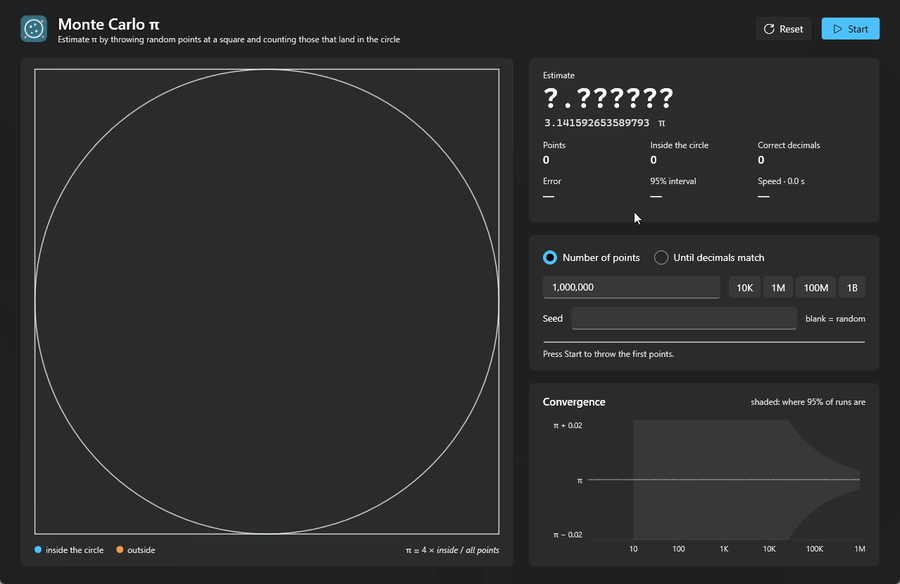
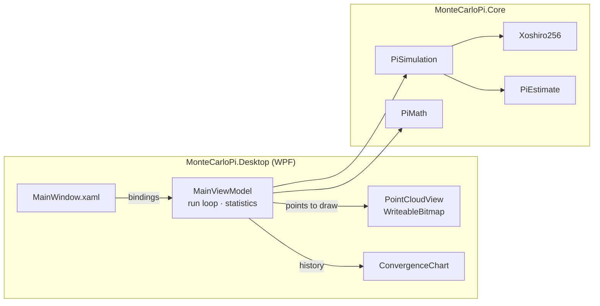
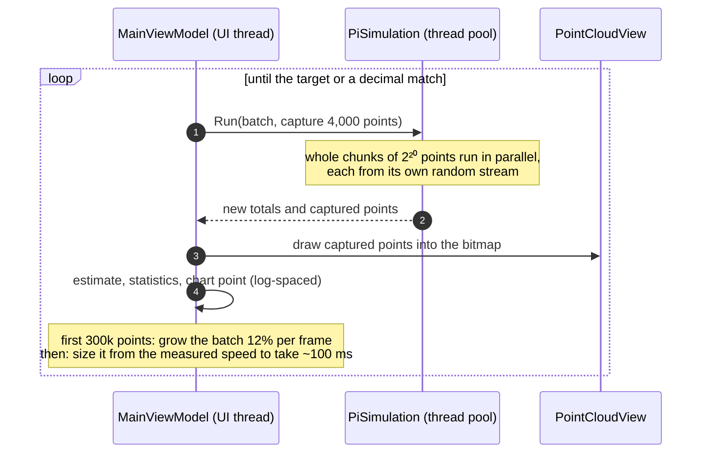

<div align="center">

# 🎯 Monte Carlo π

[](https://github.com/pero-grubac/Monte-Carlo-based-Pi-Calculator/actions/workflows/ci.yml)


**Estimate π by throwing random points at a square: watch them land, see the digits turn green as they become correct, and follow how slowly Monte Carlo converges.**



</div>

---

## 📌 Project Overview

A circle of radius 1 inside the square [−1, 1]² covers π/4 of it. Throw points at the square uniformly at random, and the share that lands inside the circle approaches π/4, so

```
π ≈ 4 × (points inside the circle) / (all points)
```

**Monte Carlo π** runs that experiment live. The square fills with points, the estimate updates with its correct digits in green, and a chart shows the error shrinking with the number of points, inside the band where 95% of all runs end up.

| Mode | You choose | It stops |
|------|------------|----------|
| 🔢 **Number of points** | Any count (`1000000`, `1e6`, `2.5M`, `1B`) or a preset | After exactly that many points |
| 🎯 **Until decimals match** | 1 to 8 decimals | At the first point where the estimate's decimals equal π's (or after 10 billion points) |

---

## ✨ Features

- 👀 **Live picture**: the first points arrive slowly so you can watch them, then the run speeds up to full speed. Millions of points stay on screen.
- 🟢 **Digits that turn green**: the correct decimals of the estimate are highlighted against π's own digits
- 📈 **Convergence chart** on a log scale, with the theoretical 95% band `± 1.96 · 1.642 / √N` that narrows tenfold for every hundredfold more points
- 📊 **Statistics**: error, 95% interval, correct decimals, points per second, elapsed time
- 🎯 **Honest decimal search**: shows how many points you would *need* to be 95% sure of the decimals, next to how many it took to hit them by chance
- 🔁 **Reproducible**: a seed repeats a run point for point, and every run shows the seed it used
- ⚡ **Fast**: about 1 billion points per second on 12 cores, and the window stays responsive
- ⏯️ **Start, pause, resume and reset** at any time
- 🌗 **Light and dark mode** with the Windows accent colour, using the Fluent theme of WPF

### 🧮 How precise is it?

Each point is a coin flip that lands inside with probability p = π/4. The estimate's standard deviation is

```
σ(π̂) = 4 · √(p(1 − p) / N) = √(π(4 − π)) / √N ≈ 1.642 / √N
```

so every extra correct decimal costs **100 times more points**:

| Decimals (95% sure) | Points needed | At ~1 billion/s |
|--------------------:|--------------:|----------------:|
| 2 | 4.1 × 10⁵ | instant |
| 3 | 4.1 × 10⁷ | 0.04 s |
| 4 | 4.1 × 10⁹ | 4 s |
| 5 | 4.1 × 10¹¹ | 7 minutes |
| 6 | 4.1 × 10¹³ | 11 hours |

*Until decimals match* often stops much earlier, because a random estimate wanders through the right window by chance. In the demo, 4 decimals matched after 3.7 million points, with an estimate of 3.14150001, right at the edge of the window and a thousand times sooner than the table promises.

---

## 🛠️ Tech Stack

| Technology | Usage |
|------------|-------|
| .NET 10 / C# 14 | Runtime and language |
| WPF + Fluent theme | Desktop UI following the Windows theme and accent colour |
| CommunityToolkit.Mvvm | Observable properties and async commands |
| xoshiro256** | Fast, seedable random generator, implemented in the core |
| `Parallel.For` | Spreads large runs over every core |
| `WriteableBitmap` | Keeps millions of drawn points on screen at no cost |
| xUnit | Tests of the estimate, the statistics and reproducibility |
| GitHub Actions | Build, test and a self-contained `.exe` on every push |

---

## 📁 Repository Structure

```
Monte-Carlo-based-Pi-Calculator/
├── src/
│   ├── MonteCarloPi.Core/                 The simulation, no UI (net10.0)
│   │   ├── PiSimulation.cs                Throws points: in parallel, or until decimals match
│   │   ├── PiEstimate.cs                  π̂, error, standard error, 95% interval
│   │   ├── PiMath.cs                      Decimal windows, points needed for a precision
│   │   └── Xoshiro256.cs                  The random generator
│   └── MonteCarloPi.Desktop/              WPF app (net10.0-windows)
│       ├── ViewModels/MainViewModel.cs    Run loop, modes, statistics
│       ├── Controls/PointCloudView.cs     The square, drawn into a bitmap
│       ├── Controls/ConvergenceChart.cs   Error against points, with the 95% band
│       ├── Themes/Styles.xaml
│       └── MainWindow.xaml
├── tests/MonteCarloPi.Core.Tests/         xUnit tests
├── MonteCarloPi.slnx
├── Directory.Build.props                  Shared build settings
├── Directory.Packages.props               Package versions in one place
└── .github/workflows/ci.yml               Build, test, publish
```

---

## 🚀 Installation

### Download

Every push to `master` builds a self-contained `MonteCarloPi.exe` (no .NET installation needed). Open the latest [CI run](https://github.com/pero-grubac/Monte-Carlo-based-Pi-Calculator/actions/workflows/ci.yml) and download the **MonteCarloPi-win-x64** artifact.

### Build from source

**Prerequisites:** Windows 10 or 11 and the [.NET 10 SDK](https://dotnet.microsoft.com/download/dotnet/10.0).

```bash
git clone https://github.com/pero-grubac/Monte-Carlo-based-Pi-Calculator.git
cd Monte-Carlo-based-Pi-Calculator
dotnet run --project src/MonteCarloPi.Desktop -c Release
```

Use `-c Release` for real speed: a Debug build is several times slower.

To build a single `.exe` yourself:

```bash
dotnet publish src/MonteCarloPi.Desktop -c Release -r win-x64 --self-contained -p:PublishSingleFile=true -p:EnableCompressionInSingleFile=true -o publish
```

### Tests

```bash
dotnet test
```

---

## 🧭 Usage

1. **Pick a mode.**
   - *Number of points*: type a count (`1000000`, `1,000,000`, `1e6`, `2.5M`, `1B`) or click **10K**, **1M**, **100M**, **1B**.
   - *Until decimals match*: set the number of decimals with `−` / `+`. The card shows the window the estimate has to reach and how many points 95% certainty would take.
2. **Optionally enter a seed.** Leave it blank for a new random run. The seed of every run is shown under the progress bar, and entering it again repeats the run exactly.
3. **Start** (`Ctrl+Enter`). **Pause** (`Ctrl+P`) and **Resume** continue the same run. **Reset** (`Ctrl+R`) clears everything.
4. **Read the result.** Green digits are correct. The *95% interval* says how far from the estimate π can still be. The chart shows whether this run stayed inside the shaded band, which 95% of runs do.

---

## 🏗️ Architecture

The simulation is a plain library. The window runs it batch by batch on background threads and only receives counts and a few thousand points per frame to draw.



### One frame of a run



---

## 🧭 Design Decisions

- **Reproducible however the work is split.** Point number *i* always comes from random stream ⌊i / 2²⁰⌋ of the seed. A run gives the same result in one call or in a thousand, on one thread or twelve. The tests check this, and the decimal-search demo stops at the same point (3,698,148) in the app as in a plain loop.
- **Own random generator.** `new Random(seed)` falls back to an old, slow algorithm for compatibility. xoshiro256** is small, fast and seedable, and independent streams come from SplitMix64.
- **The full circle in [−1, 1]².** The first version used a quarter circle in [0, 1]². The full circle gives the same ratio and a picture that reads at a glance.
- **Decimals compared by truncation.** "Two decimals match" means the estimate is in [3.14, 3.15). The old check compared a relative error against π, which made no promise about the digits and could loop forever on the UI thread.
- **The statistics say what the digits cannot.** The 95% interval and the *points needed* line explain why a lucky match is not precision.
- **A responsive window.** The old version froze while computing. Now batches run on the thread pool, and their size follows the measured speed. Points are written into a bitmap, so drawing costs the same at a thousand points as at a billion.
- **CI only when code changes.** Edits to the README, images or license do not start a build.

---

## 📄 License

[MIT](LICENSE.txt) © 2025 Pero Grubač
